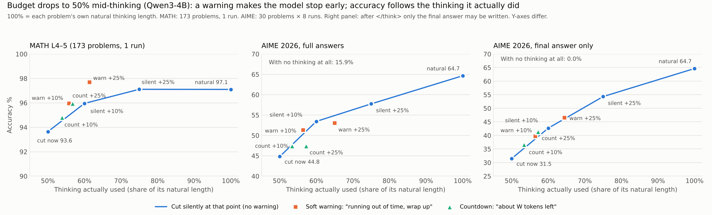

# Sudden thinking-budget drop: warn the model or just cut it? (RTX 4090, Qwen3-4B, 2026-10-18/19)

## Question

Under load, a serving system may suddenly shrink the thinking budget of a request that is already part-way
through its reasoning. Harry proposed training the model (SFT + RL) to adapt to such a mid-generation budget
change. Before anyone trains, these tests ask:
- How much accuracy does a sudden drop cost?
- How much does a plain prompt (a warning) win back without any training?
- What is the baseline a trained model would have to beat?

**Test A** used 173 MATH-500 level 4–5 problems. It drew two fair objections:
- The problems sit near the accuracy ceiling (97%).
- The model may have seen MATH-500 in training.

**Test B** answers both. It uses AIME 2026, held in February 2026 after Qwen3 was released, and samples each
problem 8 times.

**Test C** answers a third objection, raised by Harry from the traces: after a cut, the model often solves the
problem again in its answer, so the answer hides part of the cost of the cut. Test C rescores the same AIME
traces with the answer limited to the final result.

## Setup (all tests)

- **Hardware and engine.** RTX 4090 (WSL2), vLLM 0.31, Qwen3-4B, temperature 0.6.
- **Natural run.** Each problem (and, in Test B, each sample) first thinks naturally. Its natural thinking
  length L is the 100% mark for that trace.
- **The drop.** At p = 50% of L, the remaining allowance drops to W, where W is 10% or 25% of L.
- **Same prefix for every arm.** All arms reuse the same natural trace up to p.

| Arm | What happens at the drop |
|---|---|
| `natural` | No drop; the model's own answer |
| `no_think` | No thinking at all; answer forced at once (Test B only) |
| `cut_now` | Thinking stops at p; answer forced with Qwen's early-stop phrase + `</think>` |
| `cut_now_hard` | Same, but with a bare `</think>` |
| `silent_W` | Model is not told. It keeps its natural trace up to p + W, then the answer is forced |
| `warn_soft_W` | Inserted at p: "Wait, I'm running out of time. I need to wrap up my reasoning quickly and give the final answer soon." The model continues for up to W tokens. If it closes `</think>` itself it answers; otherwise the answer is forced at p + W |
| `warn_count_W` | Same, but the notice says "I only have about W tokens of thinking left..." |

`silent_W` and `warn_*_W` share the same cap p + W, so they compare directly. Thinking is hard-capped; only the
answer after `</think>` is free (up to 4,096 tokens).

## Test A: MATH L4–5

**Setup.** 173 problems whose natural thinking finished under 8,192 tokens and is at least 400 tokens long
(median 3,980). One run per problem. CIs are paired bootstrap 95% over problems.

| Arm | Accuracy % | Thinking used | Answer tokens | Total tokens vs natural |
|---|---|---|---|---|
| `natural` | 97.1 | 1.00 | 713 | 1.00 |
| `cut_now` | 93.6 | 0.50 | 737 | 0.57 |
| `cut_now_hard` | 93.1 | 0.50 | 795 | 0.58 |
| `silent_0.1` | 96.0 | 0.60 | 728 | 0.66 |
| `warn_soft_0.1` | 96.0 | 0.56 | 702 | 0.62 |
| `warn_count_0.1` | 94.8 | 0.54 | 723 | 0.60 |
| `silent_0.25` | 97.1 | 0.75 | 723 | 0.79 |
| `warn_soft_0.25` | 97.7 | 0.61 | 719 | 0.69 |
| `warn_count_0.25` | 96.0 | 0.57 | 708 | 0.63 |

- **Cost of the drop.** It costs 3.5 points (97.1 → 93.6). A 25% window wins all of it back
  (`silent_0.25` − `cut_now` +3.5, CI 0.0 to +6.9).
- **Warning vs silent.** No warning differs from `silent` at the same cap; every CI includes 0.

## Test B: AIME 2026

**Setup.**
- **Problems.** 30 problems (`MathArena/aime_2026`), 8 natural samples each, 240 traces.
- **Context.** Thinking may use the full 40,960-token context.
- **Excluded traces.** 8 traces ran out of context and are excluded.
- **Natural thinking on the remaining 232.** Median 12,706 tokens, mean 14,854.
- **CIs.** Bootstrap 95% over problems; all samples of a problem are resampled together.
- **Run time.** 7.8 hours.

| Arm | Accuracy % | Thinking used | Answer tokens | Total tokens vs natural | Closed `</think>` itself |
|---|---|---|---|---|---|
| `natural` | 64.7 | 1.00 | 1,091 | 1.00 | |
| `no_think` | 15.9 | 0.00 | 2,224 | 0.14 | |
| `cut_now` | 44.8 | 0.50 | 1,357 | 0.55 | |
| `cut_now_hard` | 48.3 | 0.50 | 1,538 | 0.56 | |
| `silent_0.1` | 53.4 | 0.60 | 1,293 | 0.64 | |
| `warn_soft_0.1` | 51.3 | 0.56 | 1,266 | 0.59 | 42% |
| `warn_count_0.1` | 47.4 | 0.53 | 1,280 | 0.57 | 69% |
| `silent_0.25` | **57.8** | 0.75 | 1,210 | 0.78 | |
| `warn_soft_0.25` | 53.0 | 0.65 | 1,245 | 0.66 | 53% |
| `warn_count_0.25` | 47.4 | 0.57 | 1,299 | 0.59 | 77% |

`natural` is 62.5% if the 8 traces that ran out of context are counted as wrong.

| Paired difference | pp | 95% CI |
|---|---|---|
| `natural` − `no_think` | +48.7 | +34.2 to +62.9 |
| `natural` − `cut_now` | +19.8 | +12.4 to +28.2 |
| `silent_0.25` − `cut_now` | +12.9 | +7.5 to +18.8 |
| `silent_0.1` − `cut_now` | +8.6 | +4.3 to +13.3 |
| `warn_soft_0.25` − `cut_now` | +8.2 | +3.8 to +12.9 |
| `warn_soft_0.25` − `silent_0.25` | −4.7 | −8.5 to −1.3 |
| `warn_count_0.25` − `silent_0.25` | −10.3 | −16.4 to −5.2 |
| `warn_soft_0.1` − `silent_0.1` | −2.2 | −6.6 to +2.2 |
| `warn_count_0.1` − `silent_0.1` | −6.0 | −10.6 to −1.8 |
| `warn_soft_0.25` − `silent_0.1` (similar thinking: 0.65 vs 0.60) | −0.4 | −3.3 to +2.5 |
| `natural` − `silent_0.25` | +6.9 | +3.0 to +11.5 |
| `natural` − `silent_0.1` | +11.2 | +6.0 to +17.5 |
| `cut_now_hard` − `cut_now` | +3.4 | 0.0 to +7.1 |

The table below groups problems by how often the model solved them with natural thinking:

| Group | Problems | `natural` | `no_think` | `cut_now` | `silent_0.25` | `warn_soft_0.25` | `warn_count_0.25` |
|---|---|---|---|---|---|---|---|
| Always solved | 14 | 100.0 | 31.2 | 78.6 | 93.8 | 87.5 | 83.9 |
| Sometimes solved | 11 | 43.2 | 1.1 | 18.2 | 33.0 | 27.3 | 18.2 |
| Never solved | 5 | 0.0 | 3.1 | 0.0 | 0.0 | 3.1 | 0.0 |

## Test C: AIME 2026, final answer only

**Setup.**
- **Same traces.** The 232 finished natural traces and drop points of Test B; only the part after
  `</think>` changes.
- **Answer.** After `</think>`, every arm, `natural` included, is given "The final answer is \boxed{" and may
  write at most 48 more tokens, so no reasoning fits in the answer. The prompt is unchanged.
- **Check.** `natural` scores exactly as in Test B on all 232 traces, so the short answer does not hurt a
  trace whose thinking finished.
- **Run time.** About 3 hours, without regenerating any thinking.

| Arm | Accuracy % | Thinking used | Closed `</think>` itself | Change from Test B (95% CI) |
|---|---|---|---|---|
| `natural` | 64.7 | 1.00 | | 0.0 |
| `no_think` | **0.0** | 0.00 | | −15.9 (−27.6 to −6.1) |
| `cut_now` | 31.5 | 0.50 | | −13.4 (−21.0 to −6.5) |
| `cut_now_hard` | 32.8 | 0.50 | | −15.5 (−24.2 to −7.8) |
| `silent_0.1` | 42.7 | 0.60 | | −10.8 (−18.5 to −3.9) |
| `warn_soft_0.1` | 39.7 | 0.56 | 40% | −11.6 (−19.8 to −4.7) |
| `warn_count_0.1` | 36.6 | 0.53 | 69% | −10.8 (−16.8 to −5.5) |
| `silent_0.25` | **54.3** | 0.75 | | −3.4 (−9.3 to +1.3) |
| `warn_soft_0.25` | 46.6 | 0.64 | 53% | −6.5 (−10.8 to −2.6) |
| `warn_count_0.25` | 41.4 | 0.57 | 76% | −6.0 (−11.3 to −1.7) |

| Paired difference | pp | 95% CI |
|---|---|---|
| `natural` − `no_think` | +64.7 | +49.1 to +78.8 |
| `natural` − `cut_now` | +33.2 | +22.5 to +44.3 |
| `silent_0.25` − `cut_now` | +22.8 | +14.8 to +31.5 |
| `silent_0.1` − `cut_now` | +11.2 | +5.3 to +17.9 |
| `warn_soft_0.25` − `cut_now` | +15.1 | +7.5 to +23.7 |
| `warn_soft_0.25` − `silent_0.25` | −7.8 | −12.5 to −3.1 |
| `warn_count_0.25` − `silent_0.25` | −12.9 | −18.6 to −7.7 |
| `warn_soft_0.1` − `silent_0.1` | −3.0 | −6.2 to 0.0 |
| `warn_count_0.1` − `silent_0.1` | −6.0 | −10.6 to −2.1 |
| `warn_soft_0.25` − `silent_0.1` (similar thinking: 0.64 vs 0.60) | +3.9 | −2.1 to +10.7 |
| `natural` − `silent_0.25` | +10.3 | +4.3 to +17.4 |
| `natural` − `silent_0.1` | +22.0 | +12.6 to +32.3 |
| `cut_now` − `cut_now_hard` | −1.3 | −3.9 to +0.9 |

| Group (as in Test B) | `natural` | `cut_now` | `silent_0.25` | `warn_soft_0.25` | `warn_count_0.25` |
|---|---|---|---|---|---|
| Always solved (14 problems) | 100.0 | 58.0 | 85.7 | 81.2 | 73.2 |
| Sometimes solved (11) | 43.2 | 9.1 | 34.1 | 19.3 | 15.9 |
| Never solved (5) | 0.0 | 0.0 | 0.0 | 0.0 | 0.0 |

## Accuracy vs thinking actually used

The blue line joins the arms that are cut silently: `cut_now`, `silent_0.1`, `silent_0.25` and `natural`. The
gaps below compare each warned arm with that line at the same thinking used, using linear interpolation and
no CI.

| Warned arm | MATH: gap to line | AIME full answers: gap | AIME final answer only: gap |
|---|---|---|---|
| `warn_soft_0.1` | +1.0 | +0.9 | +1.0 |
| `warn_soft_0.25` | +1.6 | −1.9 | +0.4 |
| `warn_count_0.1` | +0.3 | −0.3 | +1.4 |
| `warn_count_0.25` | +0.8 | −3.6 | +1.8 |

## Findings

AIME numbers below are from Test C unless marked; Test C is the cleaner measure because no reasoning can hide
in the answer.

1. **On AIME 2026 the model really reasons; it is not recalling answers.** With no thinking it scores 0.0%
   (15.9% in Test B, all of it from solving the problem inside the answer). With full thinking it scores
   64.7%. AIME 2026 was held after Qwen3 was released.

2. **The cost of a sudden drop depends on difficulty, and on hard problems it is large.** Halving the thinking
   costs 3.5 points on MATH L4–5 but 33.2 points on AIME (CI +22.5 to +44.3). The problems the model solves
   only sometimes fall from 43.2% to 9.1%. Easy problems overthink; hard ones need the second half of their
   thinking.

3. **Letting the answer carry reasoning hid much of that cost.** Test B measured the AIME drop at 19.8 points.
   Limiting the answer lowers every cut arm by 3–16 points but leaves `natural` unchanged, so the answer was
   rescuing only the cut traces. The 3.4-point edge of a bare `</think>` in Test B was also this effect; in
   Test C the two ways of cutting are equal (−1.3, CI −3.9 to +0.9).

4. **Cutting silently a little later wins back most of the loss.** Keeping 25% of L more thinking recovers
   22.8 of the 33.2 points; keeping 10% recovers 11.2.

5. **A warning makes the model stop earlier, and its accuracy follows the thinking it actually used.**
   - In Test C every warned arm sits within 2 points of the silent line at the same thinking used, so a
     warning does not damage the reasoning itself. It moves the model down the curve.
   - On MATH the curve is flat, so stopping early is free: 97.7% with 0.61 of the thinking.
   - On AIME the curve is steep, so stopping early is costly: the soft warning with a 25% window scores 7.8
     points below `silent_0.25` (CI −12.5 to −3.1), because the model closes `</think>` at 0.64 instead of
     using the whole window.

6. **A countdown is the worst way to warn, because it makes the model stop soonest.** Told how many tokens are
   left, the model closes `</think>` 76% of the time with W = 25% and scores 12.9 points below `silent_0.25`
   (CI −18.6 to −7.7). Per token it is no worse than the silent line in Test C (+1.8); the 3.6-point gap in
   Test B came from the answer. This is the "panic" reported by *Are Large Reasoning Models Interruptible?*
   (arXiv 2510.11713): stopping too early, rather than reasoning worse.

7. **Tokens.** With full answers, a cut makes AIME answers grow from 1,091 to 1,357–1,538 tokens (2,224 with no
   thinking), yet total tokens still fall to 0.55–0.78 of natural. A serving system should budget thinking
   and answer together, or limit the answer as in Test C.

## What this means

- **For SFT/RL on mid-generation budget changes.**
  - On hard problems a prompt alone is not enough: every warning loses to a silent cut at the same cap.
  - The baseline to beat is a silent cut at the same cap, scored with the answer limited to the final result.
  - On AIME the headroom between that baseline and natural is 10.3 points at a 75% cap (CI +4.3 to +17.4) and
    22.0 points at a 60% cap (CI +12.6 to +32.3).
  - The useful training target is a model that, told its new budget, keeps reasoning until the budget is used
    and then answers. Warned models already reason as well per token as silent ones; they lose only by
    stopping early.
  - Budget-aware training (e.g. BudgetThinker) already exists, so novelty would have to come from handling a
    budget that changes mid-generation, and from the serving side.
- **For LifeLine.**
  - The same cut costs nothing on easy requests and about 33 points on hard ones.
  - A uniform, queue-proportional cut therefore hurts hard requests most.
  - Deciding which requests to cut and which to defer or promote matters more than the earlier simulation,
    which used the flatter MATH curve, suggested.

## Limits

- One model (Qwen3-4B), one GPU, one drop point (50% of L) and two window sizes.
- AIME has only 30 problems. Its CIs are bootstrapped over problems and stay wide.
- Traces that ran out of context (8 of 240 on AIME) or hit the 8,192 cap (on MATH) are excluded. These are
  the longest, hardest cases.
- MATH has one run per problem.
- The gap-to-line comparison uses linear interpolation between measured points and has no CI.
- Test C limits the answer to 48 tokens and grades the last `\boxed{}` in it. The `natural` check above shows
  this does not penalise a finished trace.
- Harry's Qwen3.8-27B runs (reported in chat, not included here) changed the prompt rather than limiting the
  answer, so they are not directly comparable with Test C.

## Files

| Path | What |
|---|---|
| `gpu/budget_drop_bench.py`, `gpu/run_drop.sh` | Test A (MATH). `--mock` runs without a GPU; `--limit N` runs a quick check |
| `gpu/aime_drop_bench.py`, `gpu/run_aime.sh` | Test B (AIME 2026). Runs in rounds; `--resume` continues a stopped run; `--analyze DIR` prints the analysis |
| `gpu/run_aime_final.sh` | Test C: `aime_drop_bench.py --traces <Test B folder> --answer-mode final` |
| `gpu/thinking_budget_bench.py` | Shared prompts, grading and data loading |
| `analyze_drop.py` | Test A tables and CIs from `results/gpu_drop` |
| `scripts/extra_stats.py` | Gap-to-line numbers, AIME headroom CIs and the difficulty groups |
| `scripts/final_vs_full.py` | Test C tables, gap-to-line numbers and the change from Test B |
| `scripts/plot_drop.py` | `drop_chart.png` |
| `results/gpu_hard/phase_a.jsonl` | Test A natural traces (input) |
| `results/gpu_drop/` | Test A output: `jobs.jsonl` (one row per problem and arm), `summary.json` |
| `results/gpu_aime/` | Test B output: `phase_a.jsonl` (natural traces), `natural.jsonl`, `jobs.jsonl`, `summary.json`, run log |
| `results/gpu_aime_final/` | Test C output: `jobs.jsonl`, `summary.json`, run log (natural traces are those of Test B) |
